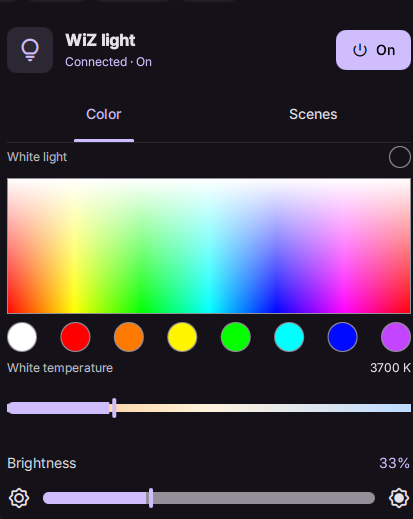
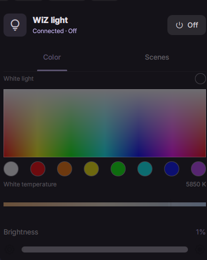

# WiZ Control for DankMaterialShell

A lightweight, local-first lighting widget for
[DankMaterialShell (DMS)](https://danklinux.com/). Control a compatible WiZ smart bulb
straight from your Linux desktop—no need to reach for your phone or open WiZ V2.

Built with QML and a small, on-demand Python standard-library helper, the widget
communicates directly with the bulb over your home LAN using the WiZ UDP protocol.
**No cloud account, VPS, home server, background daemon, or third-party Python package
is required.** This release controls **one bulb at a time**.

## Screenshots

| Light ON | Light OFF |
| :---: | :---: |
|  |  |

When the light is OFF, its settings remain visible but muted and disabled.

## Tested hardware

Development and hands-on testing have used the following bulb:

| Specification | Device |
| --- | --- |
| **Brand / product** | **Philips Smart LED Connected by WiZ — Full Color** |
| Power | **13 W** |
| Light output | **1,521 lumens** (advertised) |
| Socket | **E27** |
| Color capability | **16 million RGB colors** (advertised), warm-to-cool white |
| Connectivity | **Wi-Fi**, with local WiZ UDP control enabled in WiZ V2 |

This is the **13 W / 1,521 lm model**, **not** the 18.5 W / 2,452 lm variant.
On the tested unit, RGB, power commands, and local status reads have worked.
The controller detects usable white-temperature limits from the bulb at runtime;
marketing specifications are not used as hardcoded protocol limits.

Other WiZ-compatible bulbs **may** work, but have not been individually verified.
Feature availability, scene support, and color-temperature ranges vary by model and
firmware. WiZ Control is an independent community project; it is **not an official
Philips or WiZ app**.

## Requirements

- DankMaterialShell **1.6+** and Quickshell with its Wayland backend.
- Python 3 (standard library only).
- A reachable WiZ bulb with WiZ V2 **Settings → Allow local → Allow all controls**
  enabled. The exact app menu varies by version.
- The laptop and light must be on a LAN that permits UDP **38899** between them.
  A DHCP reservation is recommended. Broadcast discovery is not used.

Developed and checked with DMS **1.6.3**, Quickshell **0.3.2**, Qt **6.12**, and
Niri on CachyOS. Plugin APIs were checked against the installed runtime and the
[official DMS examples](https://danklinux.com/docs/dankmaterialshell/plugin-development).

## Install

From this project's directory:

```bash
mkdir -p "$HOME/.config/DankMaterialShell/plugins"
ln -s "$PWD" "$HOME/.config/DankMaterialShell/plugins/WiZControl"
```

If that destination already exists, inspect it first rather than overwriting it.
Alternatively, copy this folder there. Keep `plugin.json`, both top-level QML
files, `components/`, and `scripts/` together. The Python file needs to be readable,
not executable: it is invoked with `python3`.

1. Open **DMS Settings → Plugins**, click **Scan for Plugins**, and enable
   **WiZ Control** (`wizControl`).
2. Open its plugin settings and enter the light's **IPv4 address**. There is no
   shipped IP or MAC default. Optionally enter a name and expected MAC.
3. In **Settings → DankBar**, add **WiZ Control** to the desired widget section.
4. Click the WiZ pill. The first read discovers status and white-temperature
   limits. Use Retry if the light cannot be reached.

After editing plugin source, reload just this plugin:

```bash
dms ipc call plugins reload wizControl
```

For an update that adds properties, methods, or signals to a nested QML component,
DMS 1.6.3 can retain the old component type in its engine cache. For this scene UI
update, restart once to load the new controller methods. Also use this if reload
reports a missing property/method or leaves the old UI visible:

```bash
dms restart
dms ipc call plugins enable wizControl
dms ipc call plugins status wizControl
```

The final status should be `loaded`.

If the widget is not listed after scanning/enabling, restart DMS once with
`dms restart`, then add it to DankBar. Horizontal and vertical bars are supported.
Use one placement for one bulb: requests are serialized within each placement.

## Controls and state

- **Power** is the master switch. Confirmed OFF keeps the layout visible and
  muted, but disables tabs, colors, swatches, temperature, brightness, and scenes.
  Every control handler also checks state; the helper re-reads power before
  non-power writes. Those writes never contain `state:true`.
- Power ON sends **only** `{"state":true}`. It preserves the bulb's own last
  settings. Both power commands require a successful ACK and `getPilot` readback.
- The rectangular color field uses hue horizontally and saturation vertically,
  from white to vivid color. Brightness is separate. Click/drag or use arrow keys
  while focused; Shift makes larger color steps. Swatches and buttons support
  keyboard activation; sliders support left/right arrows.
- **Brightness is raw WiZ dimming, 1–100%**, not pywizlight's 0–255 scale. Use
  Power for OFF; zero-percent writes are not sent.
- White-temperature bounds come from `getModelConfig` (`cctRange`) or legacy
  `getUserConfig` (`extRange` / `whiteRange`). Four-value ranges use the **normal**
  inner bounds, not extended scene-only limits. If unavailable, CCT stays disabled.
  Set **both** optional verified Kelvin overrides only when your model's range
  is known. Partial or invalid overrides disable CCT.
- Status is read on every opening and every **4 seconds while the popout or
  expanded Scene Compatibility settings are visible**, without overlapping requests.
  The two views share the existing bar controller and its single request queue.
  Closing/collapsing both stops polling and discards unsent work; an already started
  command finishes within its bounded lifetime. The pill's closed-state indication
  is last-known, not a continuously monitored status.
- Drag previews update immediately; writes are coalesced at **200 ms**. There is
  at most one helper process in flight and one latest desired control value. Release
  sends the final value as soon as the current request finishes. Old polls cannot
  overwrite a newer drag. The “Applying” state lasts until hardware readback.
- A timeout is **Unavailable**, never OFF. Light controls and Power are blocked
  offline; Retry remains available. A rejected command with valid status preserves
  the actual online state and displays its error.

### RGB protocol fix

RGB is rounded to integer channels in QML, then validated as integers in 0–255
by the helper. A color command sends only `r`, `g`, `b`, and `w:0` (to clear a
previous white-channel contribution), for example:

```json
{"method":"setPilot","params":{"r":160,"g":70,"b":255,"w":0}}
```

The previous helper also sent `temp:0`, `sceneId:0`, and `c:0`. **`temp:0` is not
a valid CCT command** and mixing temperature/scene selection with RGB could reject
the entire request. Color and CCT now select their respective modes without
sending a second mode selector. Power and brightness remain separate.

The installed pywizlight 0.6.6 color CLI uses RGB-to-RGBW conversion; for the same
input it produces `r:124,g:0,b:255,w:95`, plus `state:true` and default `dimming:100`.
The widget deliberately keeps its existing direct HSV-to-RGB behavior and the
master power/brightness controls. It does not need pywizlight as a dependency.

## Scene availability

Mappings are sourced from
[pywizlight's scene table](https://github.com/sbidy/pywizlight/blob/master/pywizlight/scenes.py),
used as a protocol reference only—not a dependency.

| Scene | ID | Type |
|---|---:|---|
| Night light | 14 | Static |
| Cozy | 6 | Static |
| Relax | 16 | Static |
| Focus | 15 | Static |
| TV time | 18 | Static |
| Daylight | 12 | Static |
| Ocean | 1 | Dynamic |
| Fireplace | 5 | Dynamic |
| Candlelight | 29 | Dynamic |

Known IDs or an inferred bulb-class scene list alone do not prove your firmware
supports a scene. The main tab is for everyday selection, with no verification mode:

- **Verified scenes:** one click applies the scene immediately.
- **Not Tested:** the tile is selectable, but its first click opens a small native
  DMS dialog offering **Test & Enable** and **Cancel**. No command is sent before
  confirmation. A successful ACK plus matching ON-state `getPilot` readback enables
  and saves the scene automatically. The tested scene is left active for you to see.
- **Unsupported:** the tile is visibly disabled. Its hover/accessibility description
  gives the saved device rejection reason; advanced settings show the full explanation.

Tests, confirmations, and all lighting controls are genuinely disabled OFF/offline.
There is no automatic sweep. Timeout, malformed reply, and mismatched readback never
mark a scene verified; those failures alone do not prove a scene is unsupported.
Choosing scenes in WiZ V2 and refreshing also learns and saves observed scenes.
Dynamic effects are run by the bulb.

### Advanced → Scene Compatibility

Open **DMS Settings → Plugins → WiZ Control**, expand **Advanced**, then
**Scene Compatibility**. Both sections start collapsed. The list shows **Verified**,
**Not Tested**, and **Unsupported**, with rejection details for unsupported entries.

- **Test / Retry** opens an explicit **Test & Enable / Cancel** confirmation for
  that individual scene. A retry leaves the existing result intact until accepted
  and matching readback succeeds. Successful retesting removes the unsupported flag
  and makes the scene selectable normally again.
- **Reset saved checks** clears saved compatibility results and legacy manual ID
  overrides. It sends no lighting command. The current active scene can be learned
  again on the next status refresh.
- **Refresh status** is read-only and remains available for reconnecting. Test,
  retry, confirmation, and reset actions are disabled while OFF or unreachable.

The settings view uses the loaded DankBar widget's existing controller, with no
second transport or service. Add/enable the WiZ bar widget to use compatibility
settings. Polling runs only while the popout or both expanded settings sections
are visible and stops once both views are closed/collapsed.

Results retain the existing per-bulb persistence, scoped to configured IP and optional
expected MAC. Changing either does not carry checks to a different configured bulb.
If a different bulb takes the same IP without an expected MAC, reset saved checks.
Older saved results remain compatible; entries without saved rejection text receive
a clear generic explanation. Existing manual-ID settings are still honored, but
entering scene IDs is no longer part of the UI workflow.

## Read-only diagnostics

From the project directory, substitute your configured LAN address:

```bash
python3 scripts/wiz_udp.py --ip <BULB_IP> --inspect status
```

This sends only `getPilot` and capability reads. Output is one JSON object with
`ok`, normalized `state`, and optional `capabilities`. Missing RGB/CCT fields are
`null`, not invented colors. Optional `--expected-mac` checks bulb identity.

State-changing CLI actions are `on`, `off`, `rgb R G B`, `brightness PERCENT`,
`temperature KELVIN`, `scene ID`, and **`scene-test ID`**. Normal scene writes require
`--supported-scenes` with your verified IDs. CCT discovers its range automatically,
or accepts both `--min-kelvin` and `--max-kelvin`. Only run write actions when you
intend to change the physical lamp. `scene-test` is an explicit one-scene write
for an unverified known ID; it requires the bulb to be ON and only reports
`verified_scene` after acknowledged, matching ON-state readback.

Errors have structured JSON on stdout and a short diagnostic on stderr. Exit codes:
**2** invalid input; **3** timeout/network; **4** malformed response/identity;
**5** OFF/unsupported/rejected/unconfirmed. The helper checks the source IP **and
UDP port**, validates response shape, and retries at most twice by default (one
initial send plus one retry). Each exchange has a fresh socket to isolate late replies.
`--timeout`, `--retries`, and `--port` are available for local diagnostics/tests.

Device rejections use `error.code: "rejected"`, preserve the actual numeric/string
device code and message in `error.device_error`, and include both in the displayed
message. Top-level and nested device errors are supported. A `success:false` ACK
without details is identified as such; a missing/non-boolean ACK is a protocol
error. These are distinct from `timeout` and `network` failures. Read-only polls
preserve control-rejection diagnostics; successful reconnects clear transport errors.

### Validate the fix on your bulb

Reload with `dms ipc call plugins reload wizControl`. With the bulb ON, try a
swatch and a short spectrum drag; check that the color changes, brightness stays
unchanged, and no temperature is sent in the RGB command. Turn OFF and check that
those controls and scene testing are disabled. In Scenes, test one scene using
the confirmation, then reload the plugin to check it remains enabled. You can also
run these explicit writes yourself when you intend to change the lamp:

```bash
python3 scripts/wiz_udp.py --ip <BULB_IP> rgb 160 70 255
python3 scripts/wiz_udp.py --ip <BULB_IP> scene-test 6
```

If a write fails, retain the complete JSON error (especially `device_error`),
not just a timeout or generic rejection label. Do not run a batch of scene writes
to discover support; the widget verifies one user-confirmed scene at a time.

For load errors, use `dms ipc call plugins status wizControl` and DMS's journal:

```bash
journalctl --user -u dms.service -b
```

Do not forward the bulb's UDP port to the Internet. If status fails, check the
configured IP, physical mains power, local-control permission, Wi-Fi reachability,
and guest-network isolation. pywizlight's CLI status error and failed broadcast
discovery are not authoritative connectivity tests.

## Tests

```bash
python3 -m unittest discover -s tests -v
python3 -m compileall -q scripts tests
python3 -m json.tool plugin.json
/usr/lib/qt6/bin/qmllint --only-explicit-categories --syntax error WiZWidget.qml Settings.qml components/WizController.qml components/ColorSpectrum.qml tests/qml/shell.qml
python3 tests/validate_qml.py
```

The transport suite uses a real loopback UDP fake bulb. It covers power preservation,
ACK/readback, RGB/CCT/brightness/scenes, OFF guards, source and identity mismatch,
unexpected methods, malformed JSON/status, missing capabilities, legacy ranges,
timeouts/retries, and CLI output/exit codes. The fake rejects invalid mixed-mode
payloads, exposing the old RGB bug. Regression checks cover spectrum/swatches,
integer conversion, device-error details, and explicit scene-test confirmation.

`validate_qml.py` requires an active Wayland session and opens a temporary **mocked**
preview. It locates DMS's extracted runtime under `/run/user/<uid>/danklinux-shell/`,
or accepts `--dms-root /path/to/DankMaterialShell/quickshell`. It uses copies of
the actual installed DMS modules with isolated XDG settings/state, opens the native
bar popout, invokes disabled event handlers, tests ON/OFF/OFFLINE recovery, stale
polls during dragging, external state synchronization, one-click verified scenes,
first-use cancel/confirm, advanced statuses/retry/reset, shared controller lifecycle,
DMS persistence/reload/device scoping, rejection handling, and cleanup. The harness
also checks the saved `plugin_settings.json` after the test instance exits. All writes go
to the loopback fake. Optional `--screenshot /tmp/wiz.png` saves previews.
Isolated DMS initialization may print missing-settings/theme-generation warnings;
the script requires its own explicit PASS markers.

## Verification and limits

- Live **read-only** status/capability probing succeeded during development. The
  tested bulb reported OFF, Relax, 100% dimming, and normal CCT bounds 2700–6500 K.
- A **user-approved live RGB comparison** reproduced the old payload's device
  error **`-32602: Invalid params`**. The corrected command was acknowledged and
  read back exactly as **RGB(160,70,255)** with brightness unchanged at **20%**.
  The original **OFF / Relax / 20%** settings were restored and confirmed.
- The documented automated development checks did not perform live scene writes.
  Subsequent hands-on use confirmed that scene selection works on the tested bulb;
  individual scene compatibility and dynamic effects are not exhaustively verified.
  CCT and brightness paths have automated/mock coverage, which does not by itself
  prove physical output for every setting.
- WiZ local UDP has no authenticated channel. Source filtering and an optional
  expected MAC help catch wrong devices but assume a trusted LAN.
- Capability/scene support differs by model and firmware. No discovery, multi-bulb
  management, scheduling, background daemon, or cloud integration is included.

## Files

`WiZWidget.qml` contains the DMS pill and themed popout; `Settings.qml` uses DMS's
native plugin settings. `components/WizController.qml` owns request/state handling;
`components/ColorSpectrum.qml` draws and handles the HSV field.
`scripts/wiz_udp.py` is the standalone standard-library transport.

## Trademarks and affiliation

This project is independently developed and is not affiliated with, endorsed by,
or officially supported by Signify, Philips, or WiZ. Product and brand names are
used only to identify the hardware and protocol with which the widget works.
